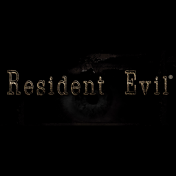
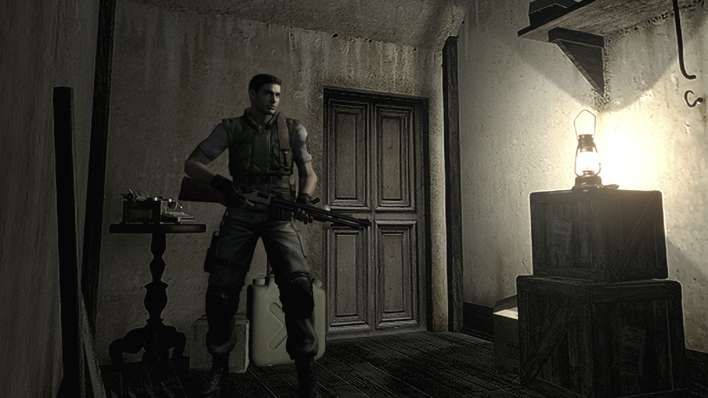

# Resident Evil HD Remaster Recomp

**Resident Evil HD Remaster Recomp** is a native Apple Silicon port of **Resident Evil HD Remaster** (Capcom, 2015),
made by statically recompiling the original Windows release.

The HD Remaster never had a Mac version. This project translates the game's own 32-bit Windows executable, function
by function, into C and compiles it for arm64, so MT Framework runs natively on macOS with no Wine, no Rosetta and no
x86 emulation at run time. The engine and game code run unchanged. The parts that talked to Windows (windows and
input, files, threads, audio, video, Steam) are replaced with native implementations, and the game's Direct3D 9
renderer is replaced with a native Metal one: no Direct3D is left, not even a translation layer.

This is an unofficial community project. It is not affiliated with or endorsed by Capcom. **You need your own copy
of the game**: none of the game's code or data files are included in this repository.

## Playing on macOS

  1. Install the **Windows** version of **Resident Evil HD Remaster** (biohazard HD REMASTER) through Steam, either in
     the Steam for Mac client or with Steam for Windows in [CrossOver](https://www.codeweavers.com/crossover). Make
     sure the game is fully downloaded and updated.
  2. Download `RE1-Recomp-macOS.dmg` from the [Releases](https://github.com/NightSightProductions/RE1-Remake-Recomp/releases) page.
  3. Open it and run **Install RE1 Recomp**. The installer finds your copy of the game, checks that it is the
     supported release, and builds the game on your Mac. The build takes about 10 minutes, needs about 3 GB of
     temporary disk space, an internet connection and Apple's Command Line Tools (the installer offers to install
     them).
  4. Launch **Resident Evil HD Remaster** from your Applications folder.

Note: release builds are not notarized by Apple yet, so macOS blocks the installer the first time it is opened. To
allow it, go to **System Settings > Privacy & Security** and click **Open Anyway**.

To build from source instead, see [Build Instructions](#build-instructions).

Some things worth knowing:
  - With the Steam for Mac client running and logged in, saves go through **Steam Cloud**, so they are shared with
    the Windows version, and the game signs in and loads its stats through the client's `libsteam_api.dylib`.
    Without Steam it runs offline and keeps its saves in `~/Library/Application Support/re1-recomp/userdata`.
  - Settings are stored in `~/Library/Application Support/re1-recomp/CAPCOM`. The game data is read from your Steam
    installation, which is never modified.
  - The resolution list matches the original: up to 2560x1600, with 16:10 modes drawn as 16:9 inside them as the
    Windows version does. Fullscreen keeps the game's aspect on screens of another shape.
  - When the installer can't precompile the game's shaders (that needs Xcode's Metal Toolchain), it compiles them
    once with macOS's own compiler at the end of setup, in about 20 seconds.
  - The app contains code translated from your copy of the game. Don't share it; share this repository instead, so
    others build it from their own copy.

### Steam Play (optional, needs NotProton)

Steam for Mac has the same compatibility-tool support as Steam on Linux, but it is switched off.
[NotProton](https://github.com/NotProtonNot/NotProton) switches it on. With NotProton installed, the installer's
**Steam Play: NSR** option (off by default) registers the game with **NightSight Recomp (NSR)**, NightSightProductions'
one Steam Play tool for all its recomps; for a source build, `python3 framework/tools/nsr.py add --appid 304240 --app
"build/Resident Evil HD Remaster.app" --exe bhd.exe --pass-paths` does the same. Restart Steam, then choose it under
**Resident Evil > Properties > Compatibility > Force the use of a specific Steam Play compatibility tool > NightSight
Recomp (NSR)**. Play on the game's own library entry then starts the native app on the Windows release Steam
installed, with the Steam overlay and playtime.

Leave the game's Steam launch options empty: with a tool other than NotProton's own, Steam for Mac can't start a
launch that has them ("OS Error 260"). Settings for the game go into NSR instead, for example
`python3 framework/tools/nsr.py set-env --appid 304240 RT_RN_FPS=1`.

Without NotProton the tool does nothing. Each launch is logged to `~/Library/Logs/nsr.log`. The installer's
uninstaller removes the game's NSR entry and keeps the tool for other games.

## How It Works

The port is built on [Recomp-Framework](https://github.com/NightSightProductions/Recomp-Framework),
NightSightProductions' static recompiler, included as the `framework/` submodule (clone with
`git clone --recursive`, or run `git submodule update --init --recursive`). Its 32-bit Windows target (`win32/`) and
Metal backend were written for this port.

  - **The executable.** The Steam release's `bhd.exe` is wrapped in SteamStub: its code section is encrypted until
    the wrapper decrypts it at startup, so it can't be translated as shipped. `tools/unwrap_steamstub32.py` does that
    decryption once, at build time, on your copy. The game still signs in through the real Steam client.
  - **Translation.** The framework's translator (`framework/win32/tools/recomp_w32.py`) turns the executable into C:
    about 32,000 functions that run against the original i386 register state, with guest memory at the addresses
    the game expects. x87 and SSE become native floating point and NEON.
  - **Runtime.** The framework's runtime (`framework/win32/runtime/`) re-implements the Windows APIs the game
    imports: kernel32, user32 windows and messages on AppKit, DirectInput and XInput (game controllers through
    Apple's GameController), XAudio2 on CoreAudio, the Windows Media Format SDK on FFmpeg for the WMV movies, and a
    Steam layer that bridges to Steam for Mac, Steam Cloud included.
  - **Metal.** The game's Direct3D 9 calls are gone. `src/render/` decodes the engine's own draw packets straight
    into the framework's Metal backend (`framework/win32/runtime/mtl_render.m`), and the engine's D3D9 call sites
    are rewritten to native code (`patches.txt`, `src/render/rn_sites.c`):
    - every one of the game's 3,152 shaders (Shader Model 3, in `nativePC/sa/DX9`) is converted to Metal at build
      time by `framework/win32/tools/sm3msl`, through [dxbc-spirv](https://github.com/doitsujin/dxbc-spirv) and
      [SPIRV-Cross](https://github.com/KhronosGroup/SPIRV-Cross);
    - pipelines are built ahead of use (when the game loads a shader package, and a frame ahead), so new rooms
      don't stutter;
    - Apple's tile GPUs are used as they want to be: clears are folded into the next pass, depth buffers that are
      only scratch stay on chip, and full-screen passes don't load what they overwrite.
  - **Steam Play.** `framework/tools/nsr.py` is the NightSight Recomp tool; Steam starts the app with the exe path
    and game folder.
  - **This repository** holds what is specific to the game:
    - `src/game.c`: the game's settings for the runtime (executable, folders, Steam app ID, bundled image);
    - `src/render/`: the native renderer for MT Framework's graphics layer;
    - `patches.txt` and `native.txt`: the call sites and functions replaced with native code;
    - `tools/arc_shaders.py` (extracts the shaders from your copy), `tools/unwrap_steamstub32.py`, `scripts/build.sh`
      and `tools/bench.sh`.

## License

The code in this repository is licensed under the terms of the **MIT License**. You can find the entire license in
the [LICENSE](LICENSE) file.

**Resident Evil HD Remaster**, its executable and data remain the property of Capcom. The C code that the build
generates from the game's code (`gen/`), the unwrapped executable, the converted shaders and the built app are
derived from the game and **must not be redistributed**; the repository is set up so that they are never committed.

The Resident Evil logo and screenshots are shown only to identify the game; the logo is a trademark of Capcom.

## Features

  - Native Apple Silicon (arm64) build of the original Windows release, with the original engine code
  - Native Metal rendering of every shader the game has, with no shader stutter
  - Keyboard, mouse and game controllers (Xbox, PlayStation, Switch Pro and MFi through Apple's GameController)
  - Steam Cloud saves shared with the Windows version
  - A `.app` bundle that finds your Steam installation by itself

## Known Issues

  - On builds without Xcode's Metal Toolchain (shaders compiled by macOS), loading a room takes longer the first
    time.

## Support and Feedback

  * [GitHub Issue Tracker](https://github.com/NightSightProductions/RE1-Remake-Recomp/issues)
  * [Discord](https://discord.gg/GKacpbpyQb)

When reporting a problem, include `~/Library/Logs/RE1-recomp.log` from the session where it happened. The log is
replaced every time the game starts (the previous sessions' logs are kept as `.prev.log` to `.prev4.log`), and Steam
Play launches are logged to `~/Library/Logs/nsr.log`.

## System Requirements

| | |
|---|---|
| macOS | 14 or later, Apple Silicon (M1 or later). Intel Macs are not supported. |
| Game | Resident Evil HD Remaster, the Windows version from Steam |
| Tools | Xcode Command Line Tools (`xcode-select --install`), with Python 3.9 or later |

The build downloads a few Python packages into a local `.venv` folder: [Capstone](https://www.capstone-engine.org)
5.0.6 and [LIEF](https://lief.re) 0.16.6 for the translator, and Meson, Ninja and CMake for the shader converter's
libraries. With Xcode's Metal Toolchain installed, the shaders are precompiled into one metallib.

## Build Instructions

  1. Clone the repository with its submodules:

     `git clone --recursive https://github.com/NightSightProductions/RE1-Remake-Recomp.git`

  2. Build the game from your copy. The usual Steam locations are searched if no path is given:

     `scripts/build.sh "/path/to/steamapps/common/Resident Evil Biohazard HD REMASTER"`

     This verifies the game files against the supported release, unwraps the executable, translates the code
     (`make gen`), extracts and converts the shaders, compiles everything (`make boot`) and creates
     `build/Resident Evil HD Remaster.app` (`make app`).

  3. Run it:

     `open "build/Resident Evil HD Remaster.app"`

     or from a terminal, with the log on screen:

     `./build/re1 "/path/to/steamapps/common/Resident Evil Biohazard HD REMASTER"`

`tools/bench.sh [seconds]` starts the app, loads save slot 1 from the title menu by itself and prints the frame rate
and GPU time per frame.

### Debugging Options

These environment variables are read by the game. For the app, pass them with
`open --env NAME=value "build/Resident Evil HD Remaster.app"`.

| Variable | Effect |
|----------|--------|
| `RT_STEAM_OFFLINE=1` | Do not connect to Steam |
| `RT_STEAM_LOCAL_SAVES=1` | Keep saves on this Mac instead of Steam Cloud |
| `RT_RN_FPS=1` | Log frame times and GPU time every 120 frames, and what each slow frame spent its time on |
| `RT_METAL_PASSES=1` | Log the GPU time of every render pass of one frame in 600 |
| `RT_METAL_NO_CLEAR_DEFER=1`, `RT_METAL_NO_SCRATCH_DEPTH=1`, `RT_METAL_NO_FULLSCREEN_SKIP=1` | Turn off one of the tile-GPU optimizations |
| `RT_SHADERS_MSL=1` | Use the shaders' Metal source over a precompiled metallib |
| `RT_RN_STRICT=1` | Stop at the first Direct3D 9 call site that isn't rewritten, instead of logging it |
| `RT_TRACE_FILES=1` | Log file opens and settings reads |
| `RT_VERBOSE=1` | Log Steam calls and more |

The log is `~/Library/Logs/RE1-recomp.log` (on screen instead when started from a terminal), and it is replaced every
time the game starts. Profiling works with Instruments: every translated function is named `F_<address>` after its
address in the original executable.

## Acknowledgements

  * [dxbc-spirv](https://github.com/doitsujin/dxbc-spirv) and [SPIRV-Cross](https://github.com/KhronosGroup/SPIRV-Cross),
    used to convert the shaders, and [DXVK](https://github.com/doitsujin/dxvk), the reference while the Metal
    renderer was written
  * [FFmpeg](https://ffmpeg.org), which decodes the movies
  * [Capstone](https://www.capstone-engine.org) and [LIEF](https://lief.re), used by the translator
  * [Steamless](https://github.com/atom0s/Steamless), whose documentation of the SteamStub formats informed the unwrap tool
